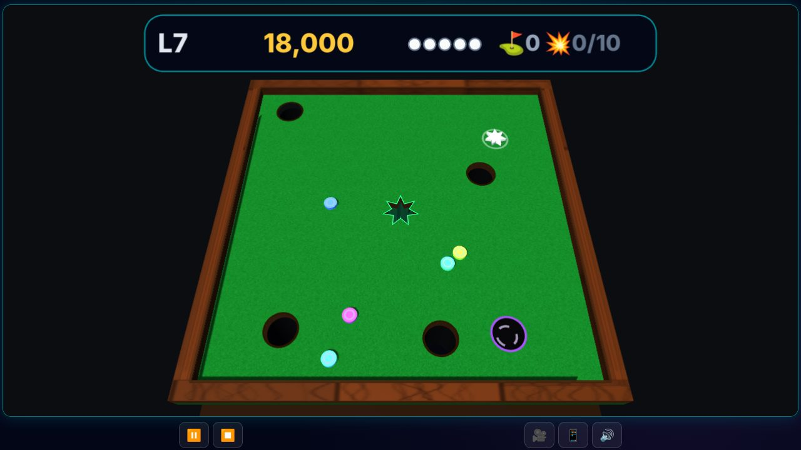

<div align="center">

# 🎯 3D Shape Putter

**Flick your shape into the matching hole, past dark pits and gliding pucks. A circle first, then a square, a triangle, a diamond, and stars with one more point every level.**

[](https://srathinagiri.github.io/ShapePutter/)
[](manifest.json)
[](#-3d-and-vr)
[](#-install-as-an-app)
[](https://threejs.org/)
[](LICENSE)

### [▶ Play now in your browser](https://srathinagiri.github.io/ShapePutter/)



🪔 *Part of the [Diwali Mega Gift Week 2026](https://srathinagiri.github.io/#gift-week): one free app every day, 6–12 November.*

</div>

---

## 🎮 How to play

1. **Press anywhere on the board and pull back**, like a slingshot. The puck goes the other way, and the further you pull, the harder the shot.
2. Sink your **white shape** in the **matching hole** in the centre. Fewer shots score more: 5,000 for a hole in one, down to 1,000 on the 5th shot.
3. **Dark holes** cost you a puck. **Coloured pucks** glide around: each hit costs 500 points, and every 10th hit in a level costs a puck.
4. You start with **5 pucks** and earn a bonus puck at every 5th level. Game over when you lose a puck with none left.
5. 🚩 **Checkpoints** (levels 1, 6, 11 …): after game over you restart from the last checkpoint, not from level 1.

The puck can only be shot once it has stopped (it glows). Tap any level you've reached in the **levels grid** to practise it: ★★★ = hole in one, ★★ = two or three shots, ★ = cleared.

🎯 **Aim guide** (`G`): a dotted path with cushion bounces and where the shot ends. Using it caps the level at ★★.

## ⌨️ Controls

| Input | Aim | Shoot |
|---|---|---|
| Touch / mouse | Pull back from anywhere on the board | Release |
| Keyboard | `←` `→` turn, `↑` `↓` power | `Space` / `Enter` |
| Gamepad / Quest | The stick points the way; how far you push it sets the power | `A` / trigger |
| Tilt aim (phone, optional) | Tilt the phone towards the shot | Tap the screen |
| Phone controller | Tilt the phone, or drag in the circle | OK |

`P` pause · `G` aim guide · `C` re-level tilt · `M` mute · `V` camera · `N` map

**Cameras:** Overview, Top-down, and ⛳ Behind the puck (golf-style, with a small board map).

## 🎱 Boards and pucks

Pick them in the menu. Each one changes both the look and the physics.

| Board | Feel |
|---|---|
| 🟩 Felt | The original green baize |
| 🪵 Carrom | Polished and quick, soft cushions |
| 🧊 Glass | Slippery; the pits glow through the floor |
| 💠 Neon | Arcade board that changes colour every 5 levels |

| Puck | Feel |
|---|---|
| ⚪ Plastic | All-rounder |
| ⚙️ Steel | Heavy: ploughs through the coloured pucks, dead cushions |
| 🔴 Rubber | Grippy and springy |

## 👓 3D and VR

- **2D**, **Parallel** and **Cross-eye** side-by-side, **Anaglyph** (red/cyan glasses), and **Smart glasses** half-SBS (RayNeo, XREAL, Rokid, TCL).
- All messages appear inside the 3D scene, so they read correctly in every mode.
- **Meta Quest (WebXR):** tap **🥽 VR** in the Quest browser. The thumbstick aims, the trigger or `A` shoots, and `B` / `Y` pauses. Play on a virtual **table** or a giant board on the **floor**.
- **Smart glasses:** turn on **📱 Tilt aim** and use the phone in your hand. Tilt towards the shot, tap to shoot.

## 📲 Phone as controller

Playing on a TV or smart glasses? Controls → **📲 Phone controller** shows a 6-digit code. Open the link it shows on a phone on the **same Wi-Fi**, enter the code, tilt to aim and press **OK** to shoot.

Pairing uses the free PeerJS signalling server once to introduce the two devices. After that, aim and button presses go **directly between your devices**, and the game itself stays offline.

## 📲 Install as an app

- **Android (Chrome or Edge):** tap **📲 Install app** in the menu header, or browser menu `⋮` → **Install app**.
- **iPhone / iPad (Safari):** Share → **Add to Home Screen**.
- **Windows / Mac:** click the install icon in the address bar.

Once installed it works fully offline. No account, no ads, no tracking.

---

## 🛠 For developers

<details>
<summary><b>Run, test and release</b></summary>

ES modules need a web server:

```bash
python -m http.server 8087      # then open http://localhost:8087
node --test tests/logic.test.mjs tests/version.test.mjs tests/solvable.test.mjs
```

Tilt aim needs **HTTPS** on real phones (GitHub Pages provides it).

- `logic.test.mjs`: the shape table and sizes, deterministic levels, clean obstacle placement, safe spawns, friction matching the 2D game, no escaping the board or tunnelling at full power, momentum conservation, mass effects, goal and hole capture and lip-outs, fairness of moving obstacles, one penalty per contact, aim-guide accuracy, scoring, bonus pucks, checkpoints, and progress merging across tabs.
- `version.test.mjs`: release versions, import maps, service-worker caching, installable icons, and the outside-host whitelist.
- `solvable.test.mjs`: a look-ahead autopilot clears levels 1–30 with the real physics (moving pucks included) without falling in a hole, and levels 1–10 on the extreme board/puck pairings (about 1 minute).

**Releasing:** bump the version in **all** of `js/config.js` (`VERSION`), `sw.js` (`CACHE_VERSION`), `manifest.json`, `index.html` and `controller.html` (badge + every `?v=`, import maps included), and the version badge in this README. The tests fail if any of them disagree. The service worker only deletes caches named `shapeputter-*` (plus the 2D game's old `shape-putter-v1`), so other games on the same `github.io` origin keep their offline copies.

</details>

<details>
<summary><b>Exact rules and physics</b></summary>

- **Obstacles:** from level 2, 2 static holes + 1 moving hole + 3 moving pucks, then 2 more holes and 2 more pucks every 5 levels.
- **Fixed boards:** each level number is a seed, so "Level 7" is the same board for everyone.
- **Lip-outs:** a puck crossing a hole very fast skims over it (goal above 8 units/s, other holes above 11).
- **Fair moving obstacles:** moving holes never drift onto the goal or under a waiting puck, coloured pucks skate around the pits, and after a hit they drift back to cruise speed.
- Leaving mid-level keeps that level's shots and hits. Restart is offered in practice only.

**Board and puck multipliers** (`BOARD_SURFACES`, `PUCK_TYPES` in `js/config.js`):

| Board | Grip | Cushion |
|---|---|---|
| Felt | 1.0× (the 2D game's 0.99 per frame) | 1.0× |
| Carrom | 0.7× | 0.85× |
| Glass | 0.4× | 1.1× |
| Neon | 1.15× | 1.05× |

| Puck | Grip | Cushion | Mass |
|---|---|---|---|
| Plastic | 1.0× | 1.0× | 1.0× |
| Steel | 0.75× | 0.6× | 2.2× |
| Rubber | 1.35× | 1.3× | 0.8× |

Collisions exchange momentum by mass, as in the 2D game (where mass = size).

</details>

<details>
<summary><b>Phone-controller security</b></summary>

`js/link.js` (ported unchanged from 3D Labyrinth) uses the official PeerJS client 1.5.5 (MIT, bundled as `js/lib/peerjs.min.js`; provenance in `js/lib/peerjs.LICENSE.txt`). The public signalling server `0.peerjs.com` introduces the devices once, and Google's public STUN server helps them find a route. TURN relays are switched off (STUN only), so game data never passes through a third party. Only whitelisted button actions are accepted, and if aim messages stop for 0.5 s the aim stops following. `tests/version.test.mjs` fails if any other outside host appears in the code. The 6-digit code is convenience pairing, not strong authentication.

</details>

<details>
<summary><b>Project structure</b></summary>

```
js/config.js     constants, rules, board/puck tables (pure)
js/levels.js     seeded level generator, shapes, safe spawns (pure)
js/physics.js    puck, discs, holes, goal, aim-guide prediction (pure)
js/rules.js      scoring, pucks, checkpoints (pure)
js/progress.js   saved run + bests, merged across tabs (pure)
js/renderer.js   stereo engine (from 3D Labyrinth / 3D Tunnel Rush)
js/board.js      three.js scene for a level (stencil-cut moving holes)
js/materials.js  procedural felt / carrom / glass / neon, pucks, reflections
js/controls.js   drag / keys / gamepad / XR / gyro / phone input
js/hud3d.js      in-scene HUD, 3D dialogs, board map
js/audio.js      Web Audio synth
js/ui.js         menus, settings
js/link.js       phone-controller pairing; js/pad.js = controller.html
js/app.js        game loop, aiming, cameras, level lifecycle, WebXR, service worker
```

</details>

Version 2 is a full 3D rebuild of the original 2D canvas game: the gameplay, shapes and scoring are the 2D game's, and the 3D engine comes from its sister project [3D Labyrinth](https://github.com/SRathinaGiri/3DLabyrinth).

**Developed by** S. Rathinagiri ([@SRathinaGiri](https://github.com/SRathinaGiri)). 2D version written with Coding Partner, an AI assistant from Google; 3D version built with Claude Code.

## 📄 License

[MIT](LICENSE) © 2025–2026 S. Rathinagiri. three.js (r128, © three.js authors) and PeerJS (1.5.5, © Michelle Bu and Eric Zhang) are also MIT-licensed and bundled unmodified in `js/lib`.
